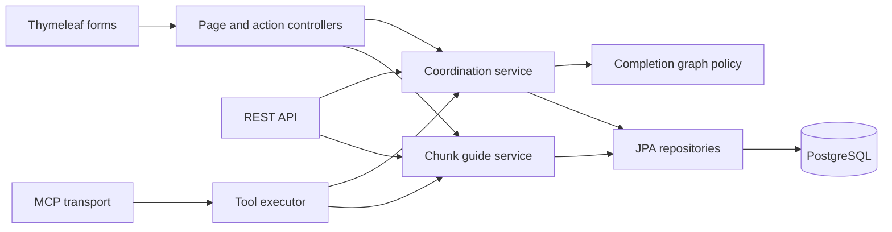

# Architecture

Relay is a modular Java monolith. A single deployment keeps project planning, coordination, and developer learning context easy to trace.

## Change boundaries

Controllers adapt transport input and record changes under the shared workspace actor. There is no account authentication or role authorization. They do not implement claim or dependency rules. DTO records and Bean Validation define the external input contracts. Domain errors are returned as Problem Details by the REST adapter and as tool errors by MCP.

`CoordinationService` owns the transaction for every change. The singleton `workspace_lock` row is locked before graph decisions, ownership changes, claim acquisition, or audit insertion. The same lock is used by the chunk guide service. This works across application replicas because the lock lives in the database.

`CompletionGraphPolicy` sees a normalized graph. Explicit prerequisite edges and implicit parent-to-child completion edges are checked together. A child cannot wait for its ancestor to finish, and cross-branch completion deadlocks are rejected. Completed parents cannot gain unfinished children.

Work-item `@Version` values protect readers from lost updates. Execution leases have a separate random claim token; a stale agent cannot submit execution progress just by obtaining a recent item version. Claims expire after 15 minutes. Heartbeats must prove the complete set of the agent's active claims, and validation happens before any lease is renewed.

Chunk guides have their own optimistic version so a long explanation does not have to share the task's coordination version. New guides are represented by version `-1`; after creation they use the persisted JPA version. Guide edits append an audit event in the same transaction.

## UI organization

`WorkspacePageController` contains GET routes. `WorkspaceViewFactory` prepares common view data; `ProjectPlanPresenter` derives project progress, milestone groups, and a suggested next chunk. `WorkItemActionController` and `AgentActionController` handle form submissions using POST/redirect/GET.

Ticket pages open in a reading view with complete, escaped plain-text sections. `?edit=true` opens the editing form; a rejected save also opens it automatically using the preserved `editForm` flash attribute. Successful saves return to the preview. See the [readable chunk preview guide](chunks/readable-chunk-preview.md) for the learning context and review steps.

Project entry links carry a `project` query parameter. The item page resolves an existing project for its return link, and forms and redirects preserve that context. Direct entry uses the chunk list as its return destination. This navigation context is kept in the web module; see the [back-to-project guide](chunks/back-to-project.md).

Feature templates are composed only inside conditional `th:block` wrappers. Keeping conditions outside replacement elements avoids Thymeleaf replacement precedence accidentally rendering unrelated pages. CSS is split by responsibility; there is no frontend JavaScript framework or duplicated client-side state machine.

## Evolution

To add multi-tenancy, introduce an explicit workspace key in every record and access query, then partition the singleton lock by workspace. To increase throughput, replace coarse locking only after documenting and testing an equivalent graph/claim consistency strategy. To add model-driven planning, integrate a model behind an explicit proposal/review flow rather than silently creating or executing a large generated plan.
